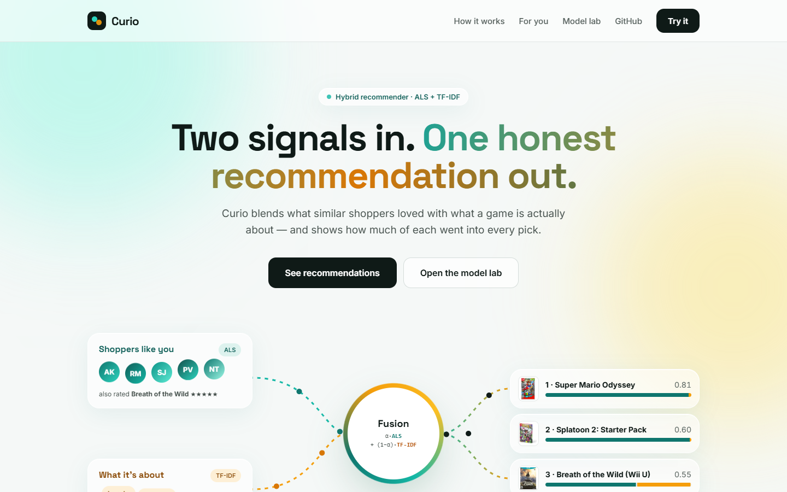
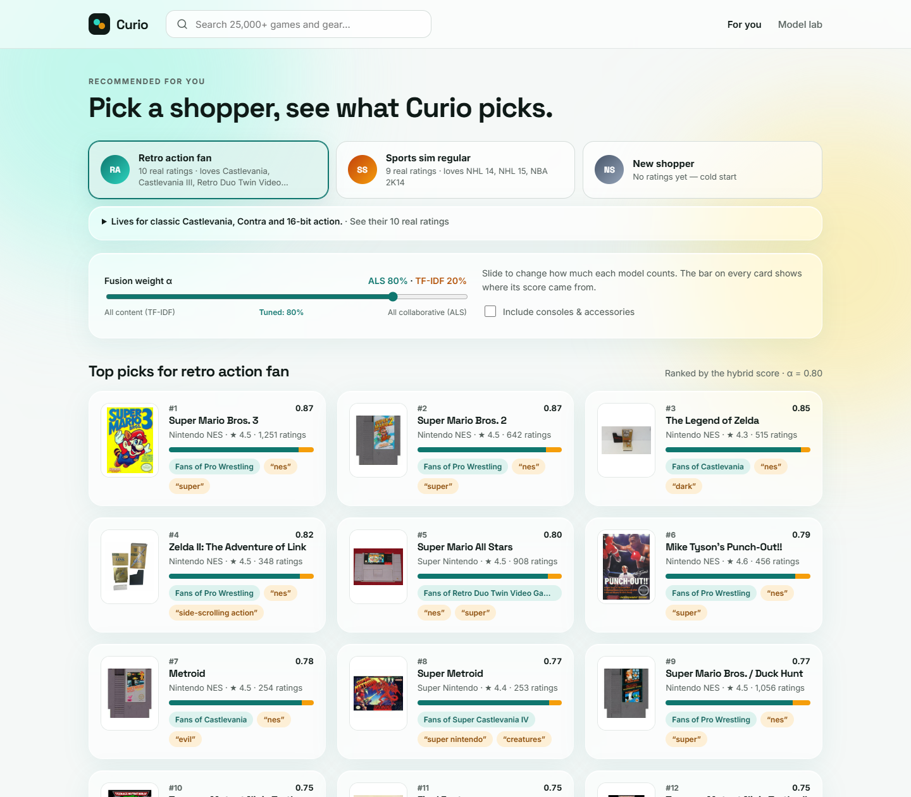
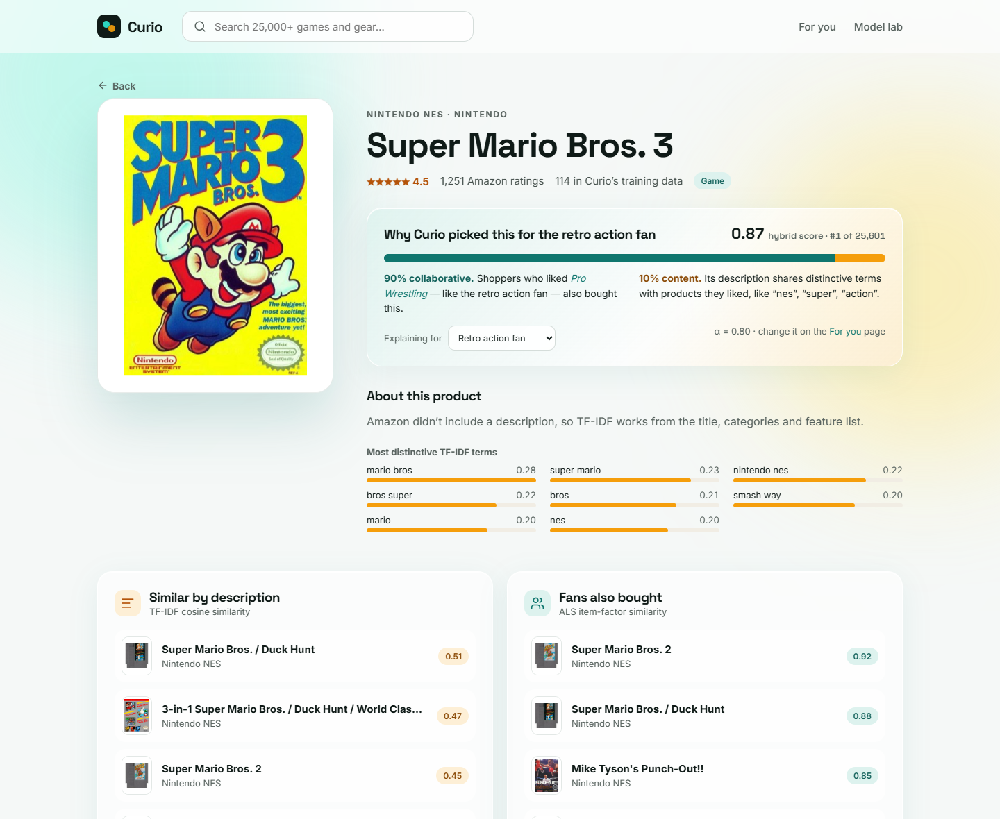
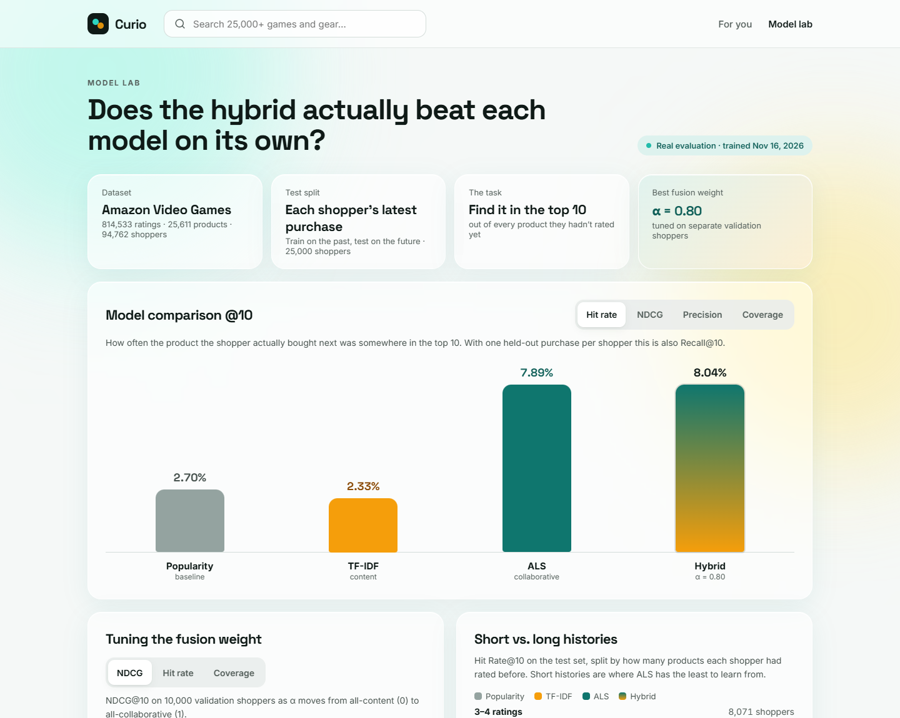

# Curio

[](https://github.com/dhruvthakur1/curio/actions/workflows/ci.yml)

A game recommender that shows its working.

Curio suggests video games and gear by combining two signals: **what shoppers like you bought** and **what the product
is actually about**. Every recommendation shows how much each signal contributed and why, down to the shared
keywords and the game you rated that led to it.

> **Live demo:** coming soon (Render and Vercel). It runs locally in a couple of commands; see
> [Running it locally](#running-it-locally).



<table>
  <tr>
    <td width="33%"></td>
    <td width="33%"></td>
    <td width="33%"></td>
  </tr>
  <tr>
    <td align="center"><sub>Recommendations + α slider</sub></td>
    <td align="center"><sub>"Why Curio picked this"</sub></td>
    <td align="center"><sub>Model lab</sub></td>
  </tr>
</table>

---

## Where this came from

During my internship at IBM I worked in a team of four on a hybrid recommendation system: ALS for user–item
interactions, TF-IDF for product content, a weighted blend of the two, and popularity as a fallback for new users.

That code belongs to IBM and used internal data, so I couldn't show it to anyone. **Curio is my own rebuild from
scratch** on a public dataset, with a proper evaluation and a UI that makes the model's reasoning visible. It's the
project I point to when someone asks what I did on my internship.

## How it works

```
 ratings ──▶ ALS (implicit)  ──┐
                               ├─▶ normalise per shopper ─▶ α·ALS + (1−α)·TF-IDF ─▶ top picks
 product text ─▶ TF-IDF ───────┘                                    │
                                     no history yet? ─▶ popularity ─┘
```

- **ALS (collaborative filtering)** learns 128-dimensional "taste" vectors for shoppers and products from 625,000
  ratings. It's good at "people who bought this also bought that".
- **TF-IDF (content)** turns each product's title, categories, features and description into a weighted keyword
  vector. It's good at "this is about the same kind of thing", even for products few people have rated.
- **The blend:** both scores are scaled to 0–1 for each shopper, then mixed with a weight α. I tuned α on held-out data
  instead of picking it by hand; it landed at **0.8**.
- **New shoppers** start with popular picks. After a **single rating** Curio personalises: it folds the new shopper into
  the trained model with one least-squares solve (about 1 ms), with no retraining.

## Does the blend actually help?

I hid each shopper's most recent purchase and asked every model to find it among **all 25,611 products**. These are the
results on 25,000 test shoppers:

| Model | Hit rate @10 | NDCG @10 | Catalogue coverage @10 |
|---|---|---|---|
| **Hybrid (α = 0.8)** | **8.04%** | **0.0441** | **18.9%** |
| ALS only | 7.89% | 0.0429 | 13.7% |
| TF-IDF only | 2.33% | 0.0116 | 76.3% |
| Most popular | 2.70% | 0.0134 | 0.07% |

What I take from it:

- The hybrid finds the real next purchase **about 3× as often as "most popular"**.
- Against ALS alone, the accuracy gain is small (around 2%). **The real win is variety:** the hybrid recommends **39%
  more of the catalogue** at the same accuracy, instead of pushing the same bestsellers to everyone.
- ~8% sounds low until you remember the task: pick one exact product out of 25,000, in 10 guesses.

The split is by time (train on the past, test on the future). The ALS settings and α were chosen on a separate
validation set, and the test set was used once, at the end. The **Model lab** page in the app shows the full α curve,
the ALS grid search and results by shopper history length.

## What you can do in the app

- **Pick a sample shopper** (two real, anonymised people from the dataset) or start fresh and rate a few games.
- **Drag the α slider** and watch the list re-rank, from pure content to pure collaborative.
- **Open any product** to see why it was picked: its rank, the ALS/TF-IDF split, the game you liked that led to it, and
  the shared keywords. Each product also has "similar by description" and "fans also bought" rails.
- **Search** all 25,000+ products.

## Tech stack

| | |
|---|---|
| Modelling | Python, pandas, scipy, scikit-learn (TF-IDF), implicit (ALS) |
| API | FastAPI; serving needs only numpy, scipy and pandas, which keeps it small |
| Frontend | React 18, React Router, Vite |
| Testing | pytest (unit tests, metric tests and API tests against a tiny synthetic model) |
| DevOps | Docker, GitHub Actions, Render and Vercel config |

## Data

[Amazon Reviews 2023](https://amazon-reviews-2023.github.io/) from the McAuley Lab at UC San Diego, Video Games
category: the 5-core ratings file (12.8 MB) and the product metadata (103 MB). After cleaning:
**94,762 shoppers · 25,611 products · 814,533 ratings**.

The raw data isn't in this repo, but the trained model files are (`server/artifacts/`, about 30 MB), so the API runs
without downloading anything.

## Running it locally

```bash
pip install -r requirements-dev.txt
uvicorn curio.api:app --app-dir server --port 8000      # API, docs at /docs
cd client && npm install && npm run dev                  # app on http://localhost:5174
python -m pytest                                         # tests
```

To retrain from scratch, download the two data files into `data/raw/` (links above), then:

```bash
python scripts/prepare_data.py    # clean and split by time
python scripts/train.py           # grid search, α sweep, test evaluation (~7 min)
python scripts/build_personas.py  # sample shoppers' histories
```

<details>
<summary><strong>API reference</strong></summary>

| Method | Path | What it does |
|---|---|---|
| GET | `/api/stats` | Dataset size and headline test metrics |
| GET | `/api/metrics` | Full evaluation: grid search, α curve, results by history length |
| GET | `/api/personas` | Sample shoppers and their rating history |
| POST | `/api/recommend` | `{persona?, ratings?, alpha?, k?, kinds?}` → ranked products with the ALS/TF-IDF split and a reason |
| POST | `/api/explain` | Why one product ranks where it does for a shopper |
| GET | `/api/items/{id}` | Product details and its most distinctive keywords |
| GET | `/api/items/{id}/similar` | "Similar by description" and "fans also bought" |
| GET | `/api/search?q=` | Title search |
| GET | `/api/onboarding` | Well-known games for new shoppers to rate |

</details>

```
scripts/          data cleaning, training and evaluation, sample shoppers
server/curio/     recommender (training), engine (serving), FastAPI app
server/artifacts/ trained model files the API loads
client/           React app: landing, recommendations, product page, model lab
tests/            pytest suite (needs no data download)
```

## Deploying

[DEPLOY.md](DEPLOY.md): the API goes on Render (Docker, free plan, about 210 MB of memory) and the frontend on Vercel.
No database or secrets are needed.

## What I'd try next

- A sequential model that cares about order, since what you buy next depends a lot on what you just bought
- Sentence embeddings instead of TF-IDF, so "metroidvania" and "exploration platformer" count as close
- Diversity re-ranking, so one franchise can't take all ten slots

---

Built by [Dhruv Thakur](https://github.com/dhruvthakur1).
